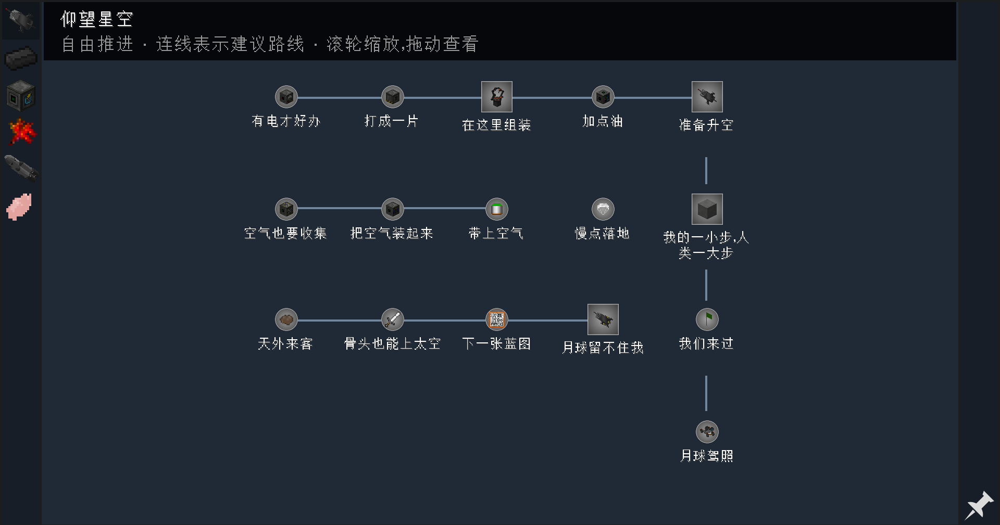
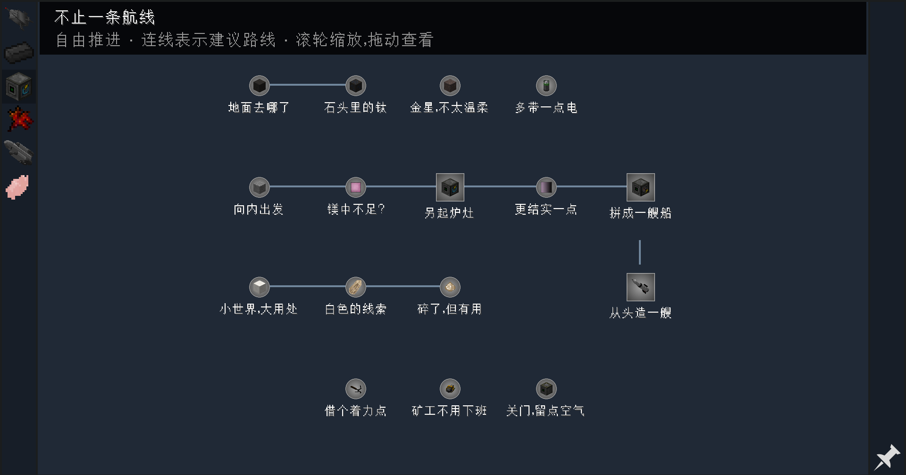
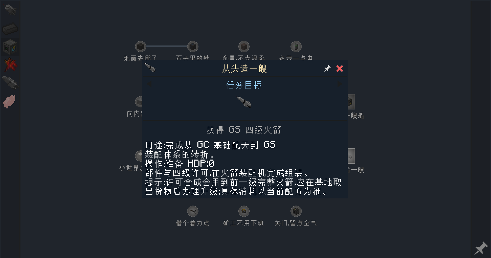

# FTB 1202.9.4 界面检查

检查日期：2026-11-02。关联 Issue #7、#12、#13。本记录只确认任务书显示与交互，不替代目标判定、生存流程或真实多人验收。

## 环境与入口

- Minecraft 1.12.2、Forge 14.23.5.2864、FTB Quests 1202.9.4、FTB Library 5.4.7.2、Item Filters 1.0.4.2。
- 使用现有客户端，通过“单人游戏”列表第一个存档“新的世界的副本”进入；输入按键前按 Shift 切换英文输入。
- 界面缩放为自动；检查最大化窗口与 854×512 窗口两种状态。
- 最终加载日志记录 `Loaded 6 chapters, 60 quests, 60 tasks and 0 rewards`，公共团队为 `ftb_public`。

## 改动范围

六章按准备、制造、目的地与工具分组重新排列；里程碑使用较大的方形节点，其他节点使用圆形。章节和目的地图标区分，节点常驻显示最多两行标题；完整标题和目标保留悬停提示。

切换章节及窗口尺寸变化时自动按可见任务范围选择初始缩放，滚轮仍可继续调整。任务书改为不透明的深色背景；详情采用深色面板、浅金标题、浅蓝目标标题与白色正文。

建议路线通过章节 `images` 展示线绘制，竖向线段避开标题。它们不是 `dependencies`，不会锁任务、改变完成资格或使历史物品自动补记。任务 ID、条件 ID、目标判定、文案、非消耗和无奖励设置保持不变。

## 已检查结果

| 检查项 | 结果 |
| --- | --- |
| 六章逐章打开与切换 | 已检查；章节标题和图标对应，各章任务可显示 |
| 第一章与第三章的密集布局 | 自动缩放可显示整章；标题不再依赖逐个悬停 |
| 长标题 | 最多显示两行，过长时省略，悬停可查看完整标题 |
| 建议路线 | 可显示；首轮发现细线取整为零，已增加可渲染厚度；竖向线段为文字留空 |
| 大、小窗口切换 | 已检查自动缩放；小窗口可用滚轮放大查看 |
| 滚轮放大 | 已检查；放大后允许部分内容超出视口 |
| 四级火箭任务详情 | 已打开；目标、正文、关闭按钮正常显示，无空奖励区；浅灰背景对比不足的问题已改为深色并重新检查 |
| 退出游戏再进入存档 | 已重复加载；任务定义仍为 6 章、60 任务、60 条件、0 奖励 |

本轮未执行领取目标物品、击杀 Boss、跨维度飞行或真实双人联机，也未用进度修改命令制造完成记录。因此没有据此确认目标判定、完成进度持久化或多人同步通过。自动化工具的拖动尝试未确认产生位移，本记录不将画布拖动列为已通过项目。

## 实机截图

以下图片由游戏内 F2 直接保存，没有绘制示意或后期修改。

### 第一章

### 第三章

### 任务详情

## 构建、部署与恢复

JDK 8 离线构建通过，公共团队探针 20 项通过。69 个 SNBT 文件通过 Minecraft 1.12.2 解析检查，部署章节文件与源文件一致；最终加载结果另由实际游戏日志确认。

本机已安装 `FTBQuests-1202.9.4.jar` 并更新六章配置，未改写全局 `file.snbt`、团队数据或远程服务器。分发时同时提供该版本 JAR 和对应配置，任务定义由服务器统一维护。

原 JAR、部署配置与源配置备份位于 `C:\Users\qq106\Desktop\新建文件夹\temp\_backup\codexbak_20261102-181409_Minecraft_FTB布局实机调整`。任务定义和 JAR 可以恢复；游戏正常加载、保存产生的世界变化不属于该配置备份。部署哈希与历史快照见[部署记录](../quest-config/solar-system/deployment.json)。
