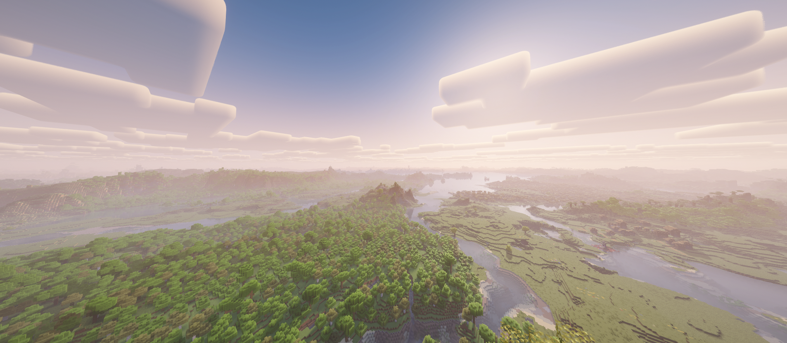
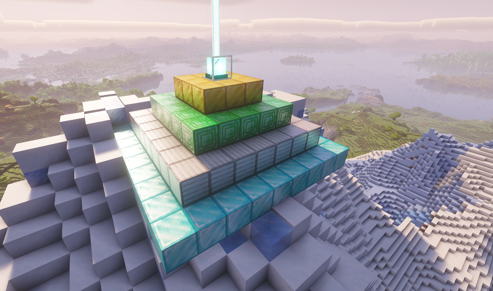

# 终章维度

当前采用 OTG 9.9 + Biome Bundle 6.1 调整配置。地形方案已获用户认可，独立维度已确认可以进入；首次抵达播放、集中加载与人物下降流程已接入管理传送入口；正式火箭的实际发射接入仍待完成，准入固定为十阶。ReTerraForged 移植停止迭代，突破 256 高度、山顶建筑和信标远景暂缓。

## 体验目标与职责

终章是独立的拟地球行星，与现有 GS 系外行星、EP 开普勒分开。世界适合行走、探索、建家与生活，保留开阔草原、平原、森林、河湖及局部高山；山地通过丘陵、缓坡和谷地衔接，不强制出生点附近的高山数量或面积。禁止敌对生物，保留动物和普通生态。

终章呼应陆地大部分被海洋吞没的地球开篇。星图沿用特拉尔斯-9 的名称与位置，并展示地球式图标和属性；抵达前不在任务文案中预告其终章设定。抵达后先留出观察、探索与安顿的空间，不强制定居。现有生态星球继续保留森林、海洋和探索价值。

维度线负责世界、景观、抵达加载和内容播放机制；飞船、核心与系外工具由[物品线](../items/README.md)负责。FTB 只记录成品和实际抵达，不替代飞船准入或抵达流程判定。



## 当前实现与验证边界

| 阶段 | 完成条件 | 当前状态 |
| --- | --- | --- |
| 一、世界与地形基础 | 固定生成方案，独立维度可进入，具备无敌对生物及正常地表环境设置 | 基础可用；地形及维度进入已由用户确认 |
| 二、抵达播放、加载与降落 | 十阶准入，首次抵达播放内容，期间集中加载，同船状态同步后安全降落 | 管理入口已接入播放、准备、同步与人物下降；实际载具接入待完成 |
| 三、交付与正式准入对接 | 最短路线、重连及保存可用，交付配置齐全；正式十阶飞船和核心接入时替换测试入口 | 待抵达流程接通后收尾 |

当前用管理命令验证首次抵达流程。完成播放后，玩家从落点上方 40 格短程下降；正式飞船、多人乘员名单和船体下降仍待物品线接入。实际火箭航行尚未验收，不作为当前管理入口测试的前置条件。

开发侧执行必要构建和自动检查；进游戏观察由用户负责，不增加复杂实机测试流程。编译和孤立检查通过不等于飞船、多人或保存重进已经验收。

## 安装与使用

运行基线为 Cleanroom 0.6.13-alpha、Java 25.0.1、OTG 9.9、Biome Bundle 6.1、DH 3.3.3、Actinium alpha-0.0.13 与 Complementary Reimagined r5.9.3。GC／GS／EP 及其依赖沿用共存实例。HIGH 是已使用的光影观察档位，最终默认性能参数尚未确定。

### 构建与配置

旧 ForgeGradle 使用 JDK 8 调度；包内保留的旧地形核心仍由 JDK 25 编译。在仓库根目录执行：

```powershell
$env:JAVA_HOME = 'C:\Program Files\Java\jdk1.8.0_8u202_x64'
$env:NEWEARTH_JAVA_HOME = 'C:\Users\qq106\AppData\Roaming\.minecraft\runtime\java-runtime-epsilon'
py -3 tools/build.py --target newearth --offline
```

缓存不足时去掉 `--offline`。最终 JAR 与 `NewEarth-BiomeBundle-<版本>.zip` 位于根目录 `build/libs/`。组合包包含 NewEarth、六个群系覆盖配置及必需的 EP／GS 星球配置；须另行安装 OTG 与 Biome Bundle。先让 Biome Bundle 生成完整原始预设，再覆盖组合包，实例中只保留一个 NewEarth JAR。客户端与服务端使用相同的模组、预设和玩法配置。当前组合不包含 Depths Update，不要求扩高。

`biome-bundle/WorldBiomes/` 保存持续维护的覆盖配置：Steppe、Sunflower Plains、TemperateLowlands 的区域尺寸均为 5，权重分别为 99、99、90；FloatingPlains、FloatingJungle 权重为 12，Caverns 权重为 25。其余群系沿用默认预设，不改山体高度与森林内部密度；权重不等于最终面积百分比。地形配置变更使用新存档或隔离区域，已有区块不会重新生成。

### 独立维度与管理入口

星图复用旺德里奇-161 星系末尾的“特拉尔斯-9”（`trars9`），保留原星系和轨道位置，绑定终章维度。图标、星图大小和大气元数据取自地球；实际世界沿用地表提供器，采用地球式重力、昼夜、天气、水体和环境设置。右上角展示实际登陆与环境属性。

模组初始化时预先注册 OTG 维度类型。普通主世界启动后，通过 OTG 原生接口创建或加载独立目的地，预设名为 `Biome Bundle`，默认维度 ID 为 `1020`，种子沿用主世界。配置位于 `config/newearth-dimension.cfg`；ID 冲突时先修改配置，已有目的地沿用存档记录的 ID。以 Biome Bundle 为主世界的地形对照存档不重复创建同名维度。

管理员进入与返回命令为：

```mcfunction
/otg tp 1020
/otg tp 0
```

修改维度 ID 后使用对应数值。该命令为开发与管理入口，正式玩家入口由飞船提供。终章维度拦截敌对生物自然生成及进入，不改变全服难度；动物保留，天空、天气和床按地表世界设置，OTG 方块传送门入口关闭。

`EndDimension.landing(WorldServer)` 与 `LandingSite` 提供地表候选点及保存，复用前同时检查头部空间与天空可见性，拒绝旧地下落点。首次跨维度抵达或直接登录终章进入播放流程；完成后正常重登保留当前位置，后续往返直接使用安全落点，不重复播放。无床重生使用地表候选点，有效床重生保留。

### 自动光影

安装 Actinium 和 `ComplementaryReimagined_r5.9.3.zip` 后，进入终章维度自动启用该光影，离开或断开连接时恢复进入前的光影包与开关；直接登录终章同样生效。仅在维度切换时重载，编译光影时可能短暂停顿。缺少依赖或光影包时跳过，不影响进入世界；原有光影画质参数沿用客户端配置。自动切换不覆盖磁盘中的原设置，专用服务端不加载光影接口。

### 本机实例

测试根目录为 `C:\Users\qq106\project\Minecraft\.local\newearth-render\`，共用 `libraries/`、`assets/`、`natives/`，各游戏目录独立保存配置、模组和存档。

| 用途 | 启动入口 | 游戏目录 |
| --- | --- | --- |
| 当前 Biome Bundle 与终章接入 | `launch-otg.cmd` | `game-otg/` |
| 原 GC／GS 共存基线 | `launch-compat.cmd` | `game-compat/` |
| 独立光影与 DH 基线 | `launch.cmd` | `game/` |

```powershell
& 'C:\Users\qq106\project\Minecraft\.local\newearth-render\launch-otg.cmd'
```

入口使用离线测试身份。不要关闭或覆盖用户正在玩的实例。原普通世界已接受的偶发 DH 近远景缺口和竖直断面不继续专项排查，出现影响游玩的新问题再处理。测试存档、日志与截图留在各实例；专项检查沿用根目录 `build/checks/newearth/`，不提交本机环境和生成产物。

`terrain/` 保留已停止迭代的 ReTerraForged 核心、材料及检查输入；构建中的旧地形检查不证明当前 OTG 维度已完成游戏验收。旧 RTG、ReTerraForged 和扩高实例不再作为当前使用入口，历史方案由 Git 保留。

## 第二阶段：抵达播放、集中加载与降落

### 触发与测试准入

首次抵达终章时触发内容播放。星图与实际准入检查固定为十阶（`REQUIRED_TIER = 10`），低于十阶不放行；旧的 `dimension.tier6TestFlight` 开关已移除，不再提供六阶绕过。星图继续复用特拉尔斯-9，管理入口 `/otg tp 1020` 保留，用于验证播放、集中加载及人物下降。

当前仅检查飞船阶数。正式玩法要求十阶飞船及已安装、有效的最终能源核心，核心校验和正式飞船乘员接口尚待物品线接入；当前阶数门槛不代表核心校验已完成。普通火箭的实际航行仍未验收，同船多人同步不假定现有火箭支持多人座位。

取消九阶制造完成后的异步预生成方案，不再实现九阶触发、后台准备进度、负载暂停／恢复及抵达后停止后台任务。正常游戏与 DH 自身的线程机制沿用，不另建长期后台准备系统。

### 抵达流程

| 状态 | 行为与放行条件 |
| --- | --- |
| 首次抵达 | 服务端建立本次抵达会话，将玩家保持在高空安全等待状态，向会话参与者同步开始播放 |
| 内容播放与集中加载 | 客户端播放原版终末之诗内容和显示界面，服务端准备降落所需真实区块，并推动 DH 远景准备；提高生成预算，同时保持播放、音频及服务器响应 |
| 玩家看完或跳过 | 该玩家标记就绪，继续等待其他在线同行玩家及必要区域加载；不单独提前降落 |
| 降落条件满足 | 所有在线同行玩家就绪，且必要真实区块和降落路径可用后，服务端统一放行，玩家从落点上方短程下降 |
| 结束 | 交还操作，停止本次集中准备；保留区块及 DH 缓存，正常世界加载、保存和 DH 显示继续运行 |

只复用终末之诗内容和播放界面，不调用原版末地通关、重生或返回主世界的流程，不制作原创结尾文字和独立演出系统。取消正常过夜触发；普通睡眠保留正常玩法作用，FTB 不增加睡觉、放床或观看完成任务。

内容播放完或被跳过时，如果必要区域尚未就绪，显示简短的准备降落等待界面。更远处 DH LOD 不作为降落硬性等待条件；服务端准备出生点周围 11×11 个真实区块，每 tick 最多 4 个、共享约 25 ms 调度预算；单次 OTG 生成无法中途打断。客户端确认落点区块已收到后才允许下降，不等待所有远景完成。DH 通过临时 API 覆盖启用远景生成、提升线程数与运行比例，结束播放或断开连接时恢复原覆盖值；缺少 DH 时继续普通准备。区块生成与装饰在服务端主线程执行。

### 同行玩家同步与保存

当前按实际共同乘骑实体收集已在目的地的玩家；管理命令为单人会话，不强制全服观看。正式飞船的跨维度乘员名单与船体等待／下降仍需接入，不能依靠人物传送推断。服务端掌握开始、每人观看就绪、区域加载就绪和统一降落状态；文字滚动由客户端播放，不逐帧同步。

掉线玩家不阻塞其他在线成员。重连后恢复本次抵达会话的当前阶段：会话仍在等待时继续播放或等待，已经结束时进入安全的抵达位置，不重复触发全员流程。会话与玩家首次抵达／播放状态随存档保存，防止重连、重登或重复事件重新播放；后续正常往返不反复播放。

- [ ] 接通十阶火箭的实际航行，接入正式飞船乘员名单、船体等待和下降，补齐返回路线。
- [ ] 首次实际抵达后揭示终章叙事并记录 FTB H01；文案由[作者文稿](../../FTB/ftb-quest-manuscript.md#终章预留似曾相识)维护。

## 第三阶段：交付与正式准入对接

开发侧执行必要构建与针对改动的自动检查，用户完成简短游戏验收，不扩展为反复看景或复杂测试。

- [ ] 用十阶飞船走通“抵达 → 播放并集中加载 → 安全降落 → 自由游玩 → 返回”的测试路线。
- [ ] 确认单人完成／跳过、多人共同等待、掉线重连、重登与保存重启后的状态，不重复播放或卡在等待状态。
- [ ] 将运行依赖、预设与配置纳入正式客户端／服务端交付；准入固定十阶，正式飞船与核心就绪后补齐核心检查和同船往返。

## 暂缓内容

可选全局光影模式暂缓。其他星球天空与 DH 缓存隔离在正式交付时按实际影响处理。

突破 256 高度暂缓。山顶建筑与 DH 信标光束暂缓，不阻塞上述接入：保留“降落点附近最高山顶、优先雪峰、金属块多层底座与有效信标”的目标，范围、尺寸和材质在恢复该工作时确定。


